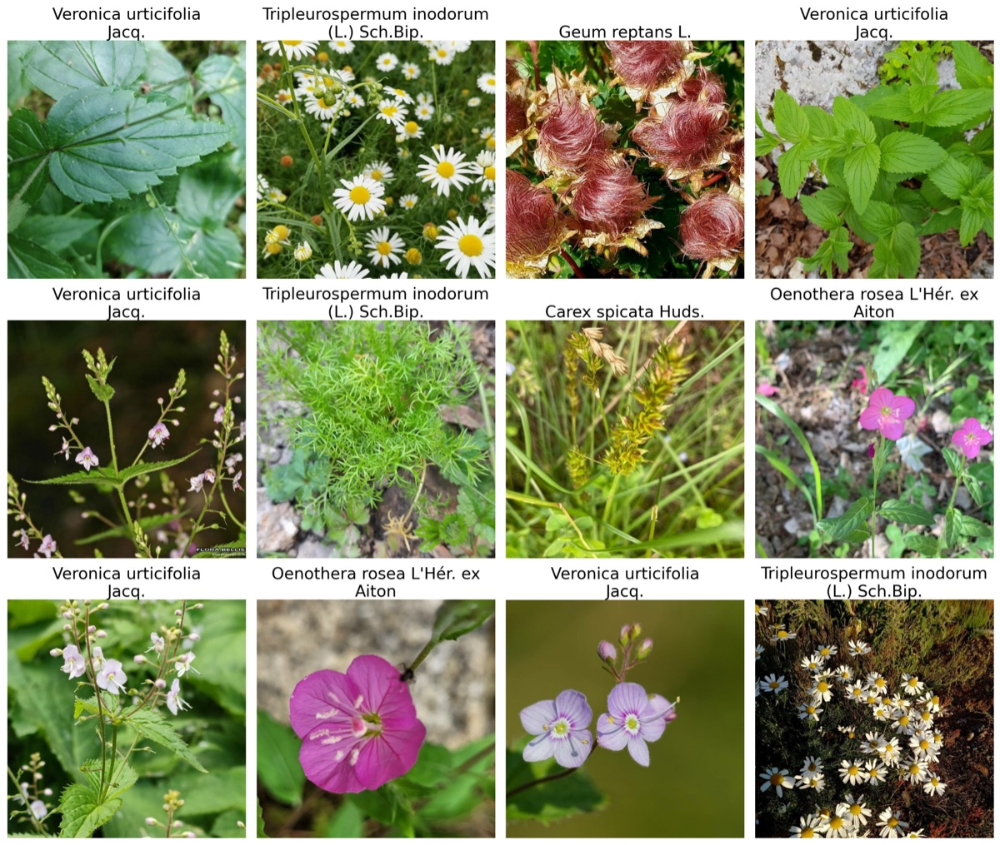
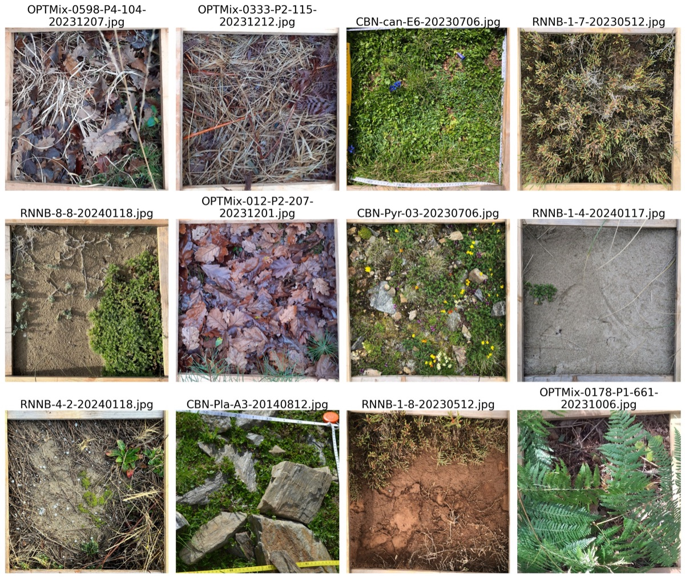
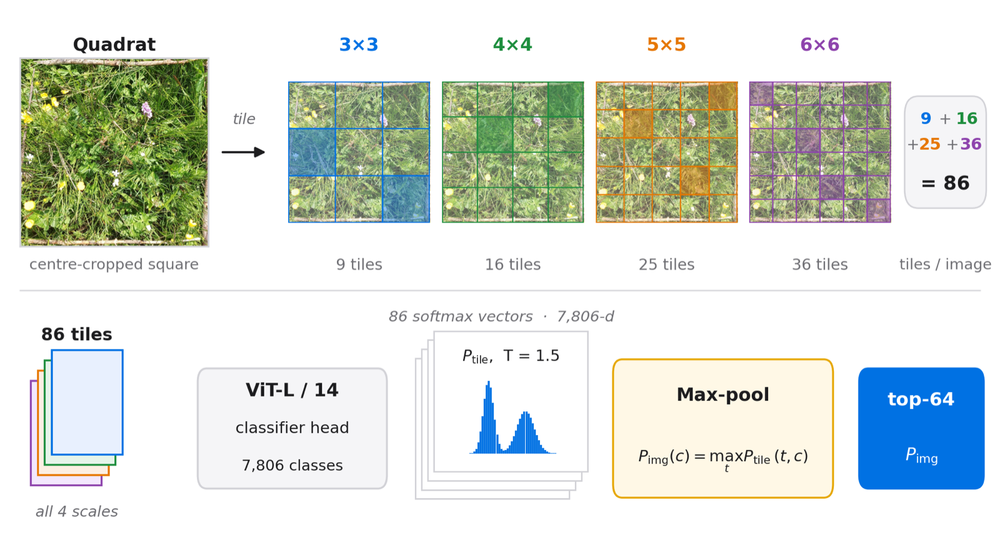
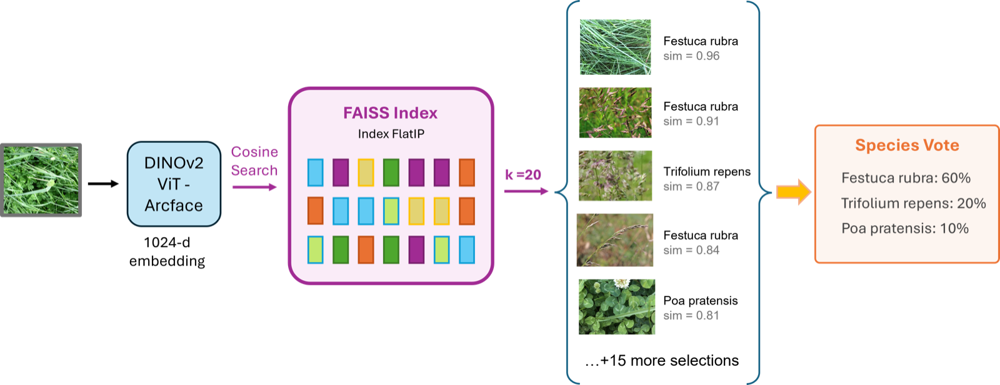
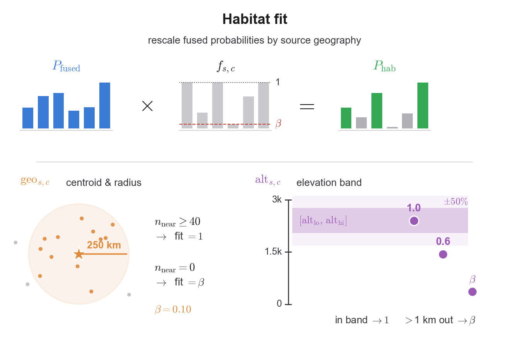

# DS@GT ARC at PlantCLEF 2026

**Multi-Scale ViT Inference with Habitat-Fit Priors and kNN Retrieval for Multi-Species Plant Identification**

Alper Erten, Murilo Gustineli, Adrian Cheung — Data Science at Georgia Tech, Applied Research Competitions (DS@GT ARC), Georgia Institute of Technology

🥉 **3rd place** in the [PlantCLEF 2026](https://www.imageclef.org/PlantCLEF2026) challenge (LifeCLEF lab, CLEF 2026, Jena, Germany)

[📄 Paper (CEUR-WS)](https://ceur-ws.org/Vol-4283/paper337.pdf) · [📑 arXiv:2607.14509](https://arxiv.org/abs/2607.14509) · [🎤 CLEF 2026 slides (PDF)](docs/slides/plantclef2026-clef-talk.pdf) · [📚 Citation](#citation)

## The task

Botanists monitor biodiversity by photographing 0.5 × 0.5 m vegetation plots (quadrats) and identifying every species inside them.
PlantCLEF asks for this to be automated: given a high-resolution (≈3000 × 3000 px) quadrat photo, predict the full set of species present.

The difficulty is a large domain shift.
The only labeled training data is 1.4M photos of **single plants** (7,806 species from South-Western Europe), often close-ups of one flower or leaf.
The 2,105 test images are cluttered **multi-species** ground-cover scenes, shot across seasons, habitats and altitudes.

| Training: one species per image | Test: every species in a plot |
|:---:|:---:|
|  |  |

Submissions are scored with a sample-level F1, averaged within each transect and then across transects.

## Our approach

The pipeline is inference-centric, built around a DINOv2 ViT-L/14 classifier that we fine-tuned on the 1.4M training images on Georgia Tech's [PACE](https://pace.gatech.edu/) cluster (4× NVIDIA H200).

1. **Multi-scale tiling.** Each quadrat is cut into 3×3, 4×4, 5×5 and 6×6 grids (86 tiles), every tile is classified, and predictions are max-pooled per species.
2. **kNN retrieval.** Each tile is also matched against a FAISS index of ~860k ArcFace/LoRA embeddings of training images, and the neighbour votes are blended with the classifier.
3. **Temporal fusion.** 76% of plots were photographed on several dates; predictions are shared across visits with a per-source aggregator.
4. **Habitat-fit priors.** Species are demoted when they are rarely observed near the plot's region or outside its altitude band, using only training-set metadata.
5. **Geographic mask and admission.** Species outside South-Western Europe are removed, and a threshold plus top-k rule picks the final set.

<p align="center">
  
</p>

<details>
<summary>kNN retrieval and habitat-fit diagrams</summary>

<p align="center">
  
</p>
<p align="center">
  
</p>

</details>

## Results

Our selected submission placed **3rd** with a private-leaderboard F1 of **0.439** (public 0.511), up from our 2025 entry's 0.348.

Removing components one at a time from the best pipeline configuration shows where the gains come from (private F1):

| Pipeline | Private F1 | Δ |
|---|:---:|:---:|
| Full pipeline | 0.458 | — |
| − kNN retrieval | 0.445 | −0.013 |
| − habitat-fit priors | 0.404 | −0.041 |
| − temporal fusion | 0.401 | −0.004 |
| − multi-scale (single 5×5 grid) | 0.385 | −0.016 |

The main takeaway: encoding how the data was collected (location, altitude, repeat visits) mattered more than adding model complexity.
Training-centric extensions — noisy-student distillation on the unlabeled LUCAS images, a label-as-query transformer decoder, and SAM 3 instance crops — did not improve results; see the paper for details.

## Code

Experiment code lives in per-member workspaces under [`user/`](user/).
The final pipeline is in [`user/alper/src/`](user/alper/src/):

| Component | Location |
|---|---|
| ViT-L/14 fine-tuning and tile embedding extraction | [`Exp-13_ViT_finetuning`](user/alper/src/Exp-13_ViT_finetuning/) |
| ArcFace/LoRA embeddings and FAISS kNN retrieval | [`Exp-9B_Improved_KNN_Retrieval`](user/alper/src/Exp-9B_Improved_KNN_Retrieval/) |
| Multi-scale aggregation, kNN blend, temporal fusion | [`Exp-11C_ViT-L_KNN_ArcFace_Conv_Ensemble`](user/alper/src/Exp-11C_ViT-L_KNN_ArcFace_Conv_Ensemble/) |
| Habitat-fit priors, geographic mask, admission | [`Exp-16_Multi_Species_Discovery`](user/alper/src/Exp-16_Multi_Species_Discovery/) |

Exploratory directions: [TileQ-Decoder](user/murilo/experiments/003-tileq-decoder/) and [SAM 3 crops](user/adrian/experiments/001-sam3-pcs/).

## Citation

```bibtex
@inproceedings{erten2026plantclef,
  title     = {Multi-Scale ViT Inference with Habitat-Fit Priors and kNN Retrieval for Multi-Species Plant Identification},
  author    = {Erten, Alper and Gustineli, Murilo and Cheung, Adrian},
  booktitle = {Working Notes of CLEF 2026 -- Conference and Labs of the Evaluation Forum},
  series    = {CEUR Workshop Proceedings},
  volume    = {4283},
  pages     = {4604--4621},
  publisher = {CEUR-WS.org},
  year      = {2026},
  url       = {https://ceur-ws.org/Vol-4283/paper337.pdf}
}
```

## Acknowledgments

We thank the DS@GT ARC group for their support.
This research was supported in part through research cyberinfrastructure resources and services provided by the Partnership for an Advanced Computing Environment (PACE) at the Georgia Institute of Technology, Atlanta, Georgia, USA.

---

## Development

This repository doubles as the team's research workspace.
Each member works under `user/<name>/`, and each experiment has its own `pyproject.toml` in a [uv](https://docs.astral.sh/uv/) workspace.

- [Getting started](docs/guides/getting-started.md): environment setup and your first experiment
- [PACE setup](docs/guides/pace-setup.md): running jobs on the Georgia Tech cluster
- [Agent tooling](docs/guides/agent-tooling.md): skills, slash commands and OpenSpec workflows
- [Documentation index](docs/README.md): concepts, references and vendor docs
- [AGENTS.md](AGENTS.md): conventions for AI assistants
