# Final Pipeline Methods Summary — PlantCLEF 2026 (F1 = 0.4379)

> **Scope.** Merged, technical-reproducible summary of every technique that contributes to the current best-scoring submission: the **Exp-11 ConvNeXt-Large DINOv3 + ViT-Base DINOv2 ensemble** (public-leaderboard F1 = **0.4379**). Synthesised from Exp-2, Exp-4, Exp-6, Exp-7, Exp-9, Exp-10, Exp-11, Exp-12, Exp-13. Rejected techniques are in the appendix.
>
> **Last updated:** 2026-04-17. **Author bundle:** alper.

---

## 0. TL;DR

| # | Technique | Source exp | Contributes to final? | Marginal F1 gain |
|---|-----------|-----------|----------------------|------------------|
| 1 | JPEG round-trip (q=85, 4:2:2) pre-embedding | Exp-2 | ✅ | ≈ +0.002–0.016 |
| 2 | `max_prob` tile→image aggregation, T=1.5 | Exp-4 | ✅ | +0.0386 |
| 3 | Temporal `prior_blend` fusion over location visits | Exp-4 | ✅ | +0.0215 (with JPEG) |
| 4 | Multiscale tiling 4+5+6 = **77 tiles** | Exp-7 | ✅ | +0.0277 |
| 5 | Fixed submission threshold (re-tuned to 0.100) | Exp-4/Exp-11 | ✅ | +0.0044 |
| 6 | ViT-only FAISS kNN blend (k=20, τ=0.07) with differentiated β_multi/β_single | Exp-9 | ✅ | +0.0165 |
| 7 | ConvNeXt-Large DINOv3 finetune (phase 1 head-only + phase 2 full) | Exp-10 | ✅ | — (enables #8) |
| 8 | ConvNeXt + ViT probability-level ensemble (Approach A, w=0.77) | Exp-11 | ✅ | +0.0204 |
| 9 | Per-model temporal-fusion alpha (α_vit = 0.15, α_cnxt = 0.30) | Exp-11 | ✅ | +0.0013 |
| — | Adaptive per-image thresholding | Exp-6 | ❌ | see appendix |
| — | Border cropping | Exp-12 | ❌ | see appendix |
| — | ViT-Large DINOv2/DINOv3 finetune (Exp-13) | Exp-13 | ⏳ planned upgrade | n/a |

**Baseline → final:** F1 0.28093 → **0.43790**  (Δ = +0.15697, **+55.8 % relative**).

---

## 1. Final-configuration reference card

```text
=================== Exp-11  Final Submission Config ===================
preprocessing
  JPEG round-trip            quality=85, subsampling=4:2:2 (PIL mode 1),
                             Lanczos resampling, applied after resize,
                             before DINO inference.

tiling (both models)
  multi-scale scheme         4×4 + 5×5 + 6×6  =  16 + 25 + 36 = 77 tiles
  tile spatial size          518 × 518 (= backbone native)
  tiles per source image     non-overlapping grid per scale

model A  (ViT branch)
  backbone                   vit_base_patch14_reg4_dinov2.lvd142m  (86 M)
  classifier head            7806-way linear
  temperature T              1.5
  aggregation                max_prob over 77 tiles,  image_topk = 64
  FAISS kNN blend            IndexFlatIP over 860K ViT training CLS embeds
                             (L2-normalised, cosine similarity)
                             k = 20,  τ = 0.07
                             β_multi  = 0.80   (multi-visit quadrats)
                             β_single = 1.00   (single-visit quadrats, no kNN)
                             p_tile = β · softmax(logits/T) + (1−β) · p_knn
  temporal fusion            prior_blend, α = 0.15

model B  (ConvNeXt branch)
  backbone                   convnext_large.dinov3_lvd1689m  (196 M)
  classifier head            7806-way linear
  temperature T              1.5
  aggregation                max_prob over 77 tiles,  image_topk = 64
  temporal fusion            prior_blend, α = 0.30

ensemble  (Approach A — probability level, AFTER ViT kNN)
  P_final = 0.77 · P_vit+knn+fused  +  0.23 · P_cnxt_fused

submission
  threshold                  0.100
  topK                       10
  geo mask                   sw_europe_mask_bool.npy  (4 792 of 7 806 classes)

>>>  F1 = 0.43790  (Kaggle public leaderboard)
=======================================================================
```

A box-and-arrow rendering of the same pipeline:

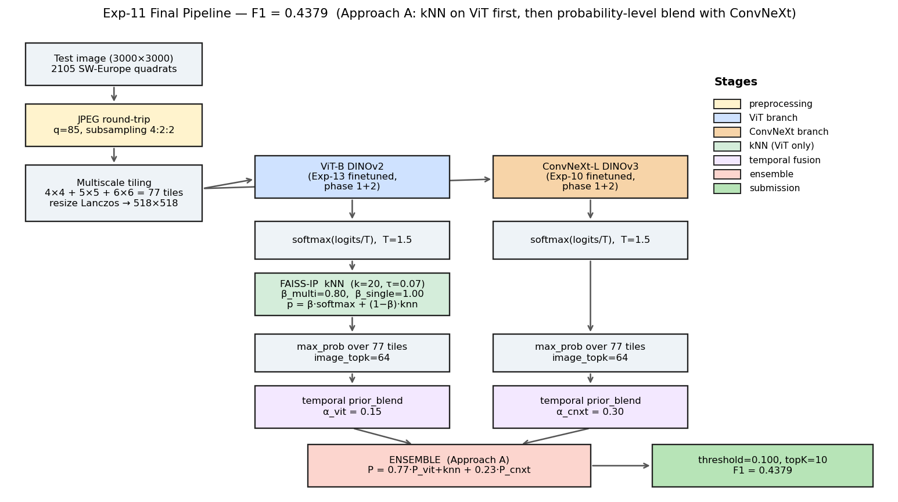

---

## 2. Result summary — absolute and incremental views

### 2.1 Absolute F1 progression across milestones

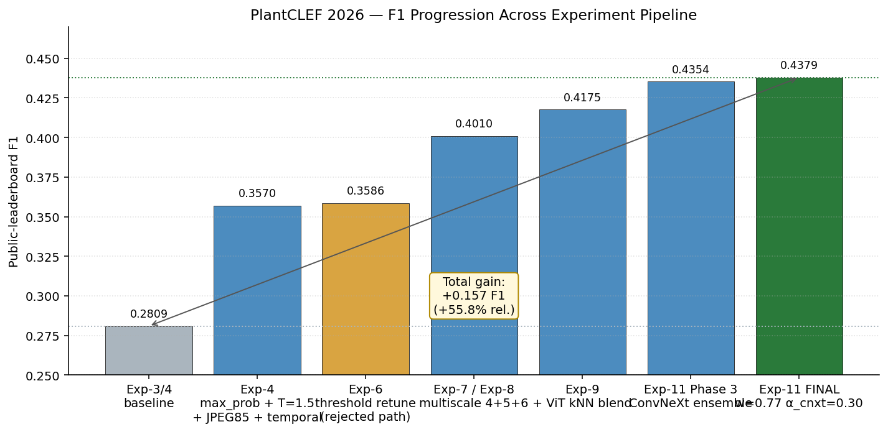

| Milestone | F1 | Δ vs baseline | Δ vs previous |
|-----------|----:|--------------:|--------------:|
| Exp-3 baseline (noisy_or, T=2.0) | 0.28093 | — | — |
| Exp-4 final (max_prob, T=1.5, JPEG85, prior_blend α=0.6) | 0.35698 | +0.07605 | +0.07605 |
| Exp-7/8 (add multiscale 4+5+6; re-tune α=0.05, thr=0.100) | 0.40100 | +0.12007 | +0.04402 |
| Exp-9 (add ViT kNN, β_m=0.80 / β_s=1.00, α=0.15) | 0.41754 | +0.13661 | +0.01654 |
| Exp-11 Phase 3 (ConvNeXt ensemble, w=0.78, α_cnxt=0.05) | 0.43540 | +0.15447 | +0.01786 |
| **Exp-11 final (w=0.77, α_cnxt=0.30)** | **0.43790** | **+0.15697** | **+0.00250** |

### 2.2 Incremental waterfall

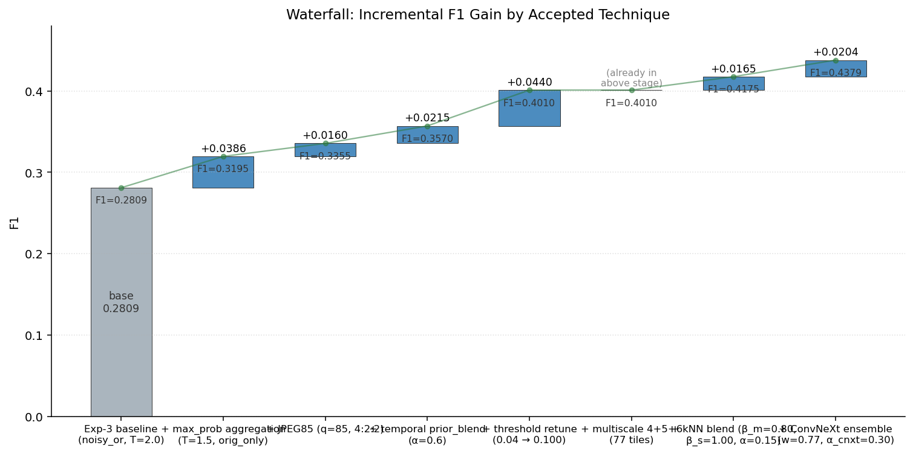

### 2.3 Contribution share to the total +0.157 F1

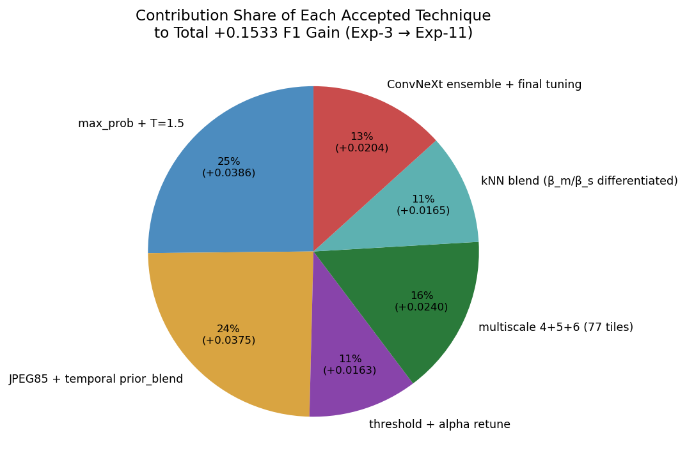

### 2.4 Cumulative view (absolute gain over baseline)

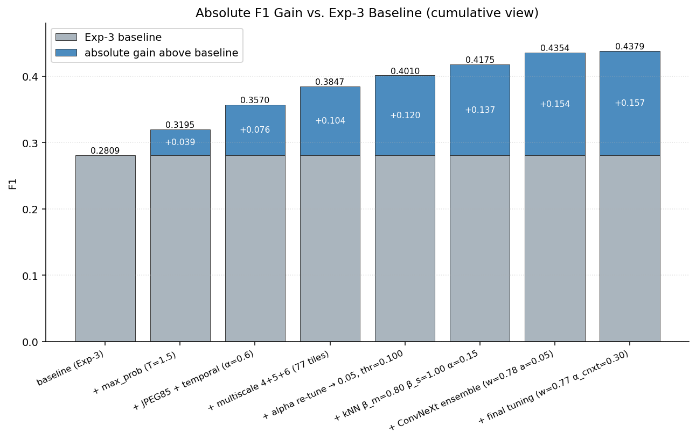

---

## 3. Dataflow overview (mermaid)

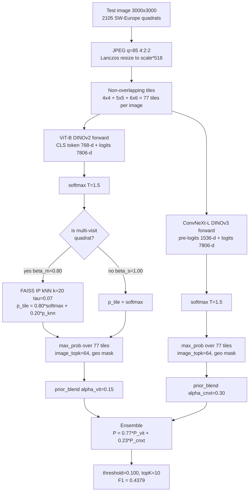

---

## 4. Techniques, in pipeline order

Each section gives: **hypothesis**, **formula / algorithm**, **hyperparameters used**, **F1 impact**, **reproducibility pointers** (paths in the `user/alper/src/` tree).

### 4.1 JPEG round-trip preprocessing (Exp-2)

**Hypothesis.** DINO models were pre-trained on natural imagery that has been JPEG-compressed at least once. Re-encoding the (uncompressed or re-saved) test images through a JPEG round-trip brings their pixel statistics closer to the training distribution.

**Implementation.** PIL `Image.save(..., format="JPEG", quality=q, subsampling=s)` followed by `Image.open(buf)`. Applied **after** the Lanczos resize to `(scale × 518) × (scale × 518)` and **before** tiling + normalisation.

```python
# Exp-2-JPEG_Compression/utils/embedding/transform.py L152–164
def _apply_jpeg_compression(image: Image.Image) -> Image.Image:
    buf = BytesIO()
    image.save(buf, format="JPEG", quality=self.jpeg_quality,
               subsampling=self.jpeg_subsampling)
    return Image.open(buf).copy()
```

PIL `subsampling` encoding: `0`=4:4:4, `1`=4:2:2, `2`=4:2:0.

**Hyperparameters used in Exp-11 final.**

| parameter | value | source |
|-----------|-------|--------|
| quality   | 85   | Exp-11 confirmed that q=85 ties q=94 from Exp-2 within noise; standardised on 85 for cross-model consistency |
| subsampling | 1 (4:2:2) | Exp-2 + Exp-11 both |

**F1 impact.** Isolated effect is small but consistent: **+0.0020 F1** on ConvNeXt 4×4 standalone (0.3165 vs 0.3148) — matches the ViT trend reported in Exp-4 (~+0.002 on the standalone stage, growing to ~+0.016 once combined with temporal fusion because it lets α shift from 0.1 to 0.6). Kept in the final pipeline because the downside is zero while the upside compounds with downstream stages.

**Reproducibility pointers.**
- Extraction entrypoint: `Exp-10_ConvNext_finetuning/extract_convnext_embeddings.py` (for ConvNeXt), `Exp-7_Multiscale_tiling/extract_multiscale_embeddings.py` (for ViT).
- Both expose `--jpeg-quality 85 --jpeg-subsampling 1`.
- Historical sbatch: `Exp-2-JPEG_Compression/step1/slurm-embed-lucas212k.sbatch` (reference implementation, now inlined).

---

### 4.2 Multiscale non-overlapping tiling 4 + 5 + 6 (Exp-7)

**Hypothesis.** A single 4×4 grid on a 3000×3000 quadrat creates tiles that often contain multiple species or fragment individuals at resolutions mismatched to DINO's training distribution. Mixing three grids (4×4, 5×5, 6×6) gives complementary crops at three effective scales (747, 600, 500 px of source → 518 px model input), so **max_prob** downstream can pick whichever tile best isolates each species.

**Algorithm.**
```
for S in {4, 5, 6}:
    center-crop the image to a square that is divisible by S
    resize to (S*518, S*518) with Lanczos
    (optional) JPEG round-trip at q=85
    split into S^2 non-overlapping tiles of 518x518
    forward through the backbone, store per-tile logits + CLS embeddings
concatenate tiles from all three scales -> 16 + 25 + 36 = 77 tiles per image
```

Parquet output schema (per tile):
`image_name, tile_index (= scale*1000 + local_idx), embedding_orig_f16 [D], teacher_logits_f16 [7806], max_prob, passed_aug_consistency`.
`D = 768` for ViT-B, `D = 1536` for ConvNeXt-L.

**Hyperparameters used in Exp-11 final.**

| parameter | value |
|-----------|-------|
| scales | {4, 5, 6} |
| tile count | 77 |
| tile size | 518×518 |
| resize filter | Lanczos |

**F1 impact (ViT single-model, Exp-7 Phase 1).**

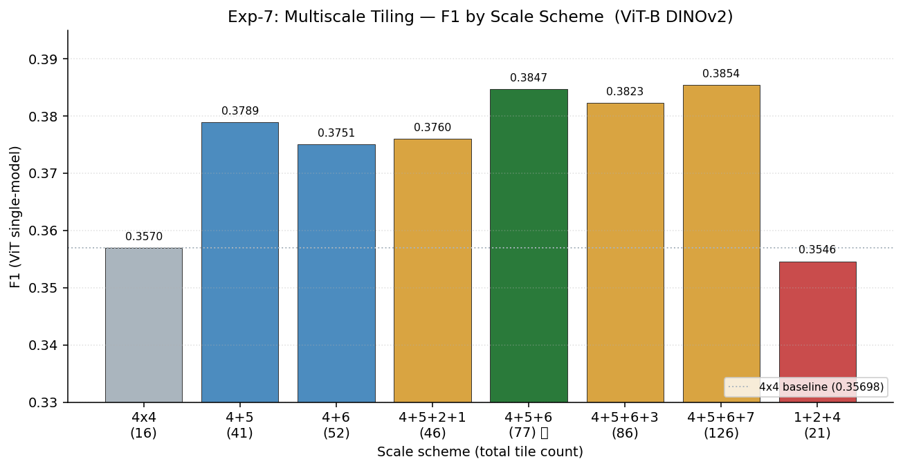

| scheme | tiles | F1 | Δ vs 4×4 |
|--------|------:|----:|---------:|
| 4×4 | 16 | 0.35698 | — |
| 4+5 | 41 | 0.37894 | +0.022 |
| 4+6 | 52 | 0.37507 | +0.018 |
| **4+5+6** | **77** | **0.38466** | **+0.028** |
| 4+5+6+3 | 86 | 0.38227 | +0.025 |
| 4+5+6+7 | 126 | 0.38542 | +0.028 (noise vs 4+5+6) |
| 1+2+4 | 21 | 0.35460 | −0.002 |

Adding coarse scales (1×1, 2×2, 3×3) **hurts** — whole-image/quadrant tiles generate confident wrong labels that max_prob promotes. Adding 7×7 adds compute for noise-level gain.

**Reproducibility pointers.**
- Extraction: `Exp-7_Multiscale_tiling/extract_multiscale_embeddings.py`
- Aggregation: `Exp-7_Multiscale_tiling/multiscale_aggregate.py`, `Exp-7_Multiscale_tiling/utils/aggregator.py`
- sbatch: `Exp-7_Multiscale_tiling/slurm_extract_multiscale.sbatch`, `slurm_extract_scale6.sbatch`, `slurm_extract_scale3_7.sbatch`
- For ConvNeXt the same scheme is re-run through `Exp-11_Conv_ViT_Ensemble/slurm_extract_convnext_4x4.sbatch` and `slurm_extract_convnext_5x5_6x6.sbatch`.

---

### 4.3 Per-tile → per-image aggregation: `max_prob` with T = 1.5 (Exp-4)

**Hypothesis.** With 77 tiles per image and a strongly multimodal species distribution, the correct label for a species often lives in **one or two tiles**. Noisy-OR compounds every tile's noise multiplicatively, mean/quantile pooling dilutes strong signals, and max-of-softmax preserves the single-best tile evidence for each class independently.

**Formula (per class c, per image).**
```
p_t(c) = softmax(logits_t / T)_c          for tile t in 1..77
p_image(c) = max_t p_t(c)
# then image_topk=64 pruning and geo-mask zeroing
```

Temperature `T` is applied only inside softmax; lower T sharpens per-tile peaks, higher T smooths.

**Sweep (Exp-4 Step 7, ViT, orig_only, k-sensitive).**

| method × T | k=6 | k=10 | k=16 |
|------------|----:|-----:|-----:|
| noisy_or T=2.0 | 0.28093 | 0.26904 | 0.24730 |
| mean_prob T=2.0 | 0.25492 | 0.24329 | 0.24086 |
| weighted_noisy_or T=2.0 | 0.26851 | 0.24771 | 0.24709 |
| **max_prob T=1.5** | **0.31487** (k=3) | **0.31950** (k=4) | robust |

`max_prob` is the only aggregator tolerant of increasing tile counts (stdev ~0.002 across k=6..16); this is *why* multiscale 4+5+6 works downstream — the 77-tile mix never degrades with max_prob.

**Hyperparameters used in Exp-11 final.**

| parameter | value |
|-----------|-------|
| aggregator | `MaxProbabilityAggregator` |
| temperature T | 1.5 |
| image_topk | 64 (sparse storage) |
| tile_filter_k | unused (keep all 77) |

**Code reference.** `Exp-4_Enhanced_Tile_Aggregation/utils/aggregator.py::MaxProbabilityAggregator.aggregate()` (L174–177). Same class is imported by Exp-7 / Exp-9 / Exp-11.

---

### 4.4 Temporal fusion: `prior_blend` across location visits (Exp-4)

**Hypothesis.** Each physical plot in the test set is photographed on multiple visits. If the same species was observed in earlier visits at that location, that is a strong prior for the current visit even when the current photo is poor.

**Construction.** For each location ℓ, collect the per-image predictions P_q of every visit q to ℓ and compute the element-wise max across visits:
```
P_location(ℓ, c) = max_{q in visits(ℓ)} P_q(c)
```
**Application (prior_blend).**
```
P_final(q, c) = (1 − α) · P_location(ℓ(q), c)  +  α · P_q(c)
# α=1 => no temporal help; α=0 => pure location prior
# applied only to multi-visit quadrats (~75.8 % of test set)
```

**Sweep (Exp-4 JPEG85 branch, ViT 4×4, k=3).**

| α | F1 |
|--:|----:|
| 1.0 | 0.33073 |
| 0.8 | 0.34504 |
| 0.7 | 0.35357 |
| **0.6** | **0.35517** |
| 0.5 | 0.35486 |

Shifts to **α=0.05** once multiscale (Exp-7/8) is added: the per-image signal becomes much stronger and the prior mainly serves as a regulariser.

**Per-model α in Exp-11 final.**

| branch | α | why |
|--------|--:|-----|
| ViT+kNN | 0.15 | the kNN blend already injects location-independent external evidence; lean modestly toward the location prior for noisy tiles |
| ConvNeXt | 0.30 | ConvNeXt has no kNN arm and already differs from ViT in its errors; letting it lean more on its own per-image prediction preserves the architecture-diversity signal the ensemble is trying to harvest |

**Reproducibility pointers.** `Exp-4_Enhanced_Tile_Aggregation/temporal_fusion.py`, functions `build_location_profiles()`, `apply_prior_blend()`, `fuse_all()`. Location identifier extracted from `image_name` via `parse_location()`.

---

### 4.5 ViT-only FAISS kNN blend (Exp-9)

**Hypothesis.** The softmax classifier is biased toward common species because the 1.4 M-image long tail was under-weighted during training. A frequency-agnostic retrieval arm provides complementary "look-up" evidence: if a test tile's embedding lies in a cluster of rare-species training embeddings, that should outvote the classifier prior.

**FAISS index (built on the ViT training set only).**

| property | value |
|----------|-------|
| index type | `IndexFlatIP` (exact) |
| vectors | ~860K (geo-filtered ViT-B CLS embeddings, L2-normalised) |
| dim | 768 |
| similarity | cosine (= IP on L2-normed) |
| labels | int32 array parallel to index |

**Query formula (per tile).**
```
(sim, idx) = FAISS.search(e, k=20)                       # sim in [-1,1]
w_i = exp((sim_i - max(sim)) / tau) / sum_j exp(...)     # tau = 0.07
p_knn(c) = sum_{i : label[idx_i] = c}  w_i               # a proper distribution
p_tile = beta * softmax(logits / T=1.5)  +  (1 - beta) * p_knn
```

**Differentiated β (Phase 3 result).** Multi-visit quadrats have the temporal prior as a noise filter; single-visit do not. Injecting kNN noise into single-visit images is catastrophic.

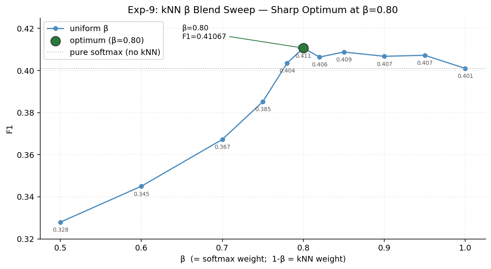

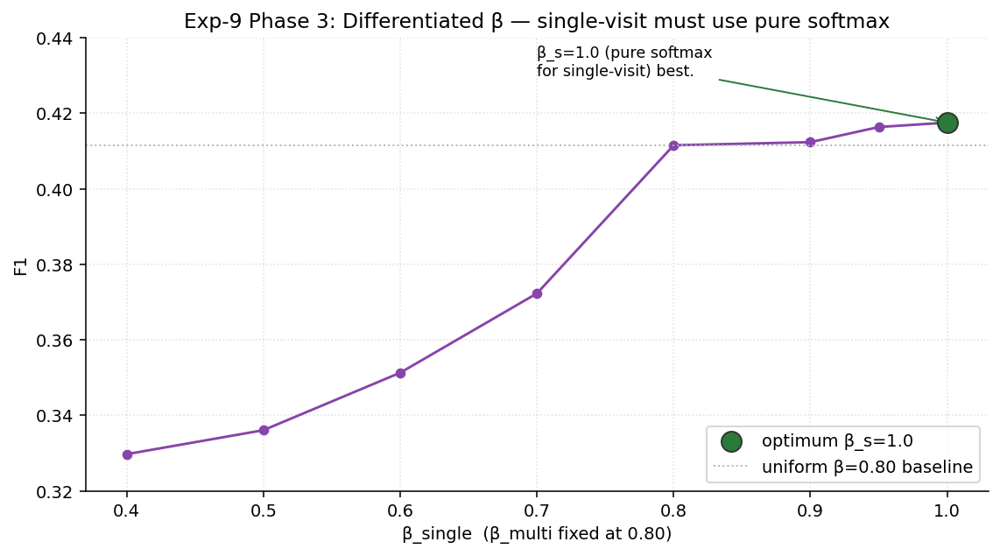

| β_multi | β_single | F1 | note |
|---:|---:|---:|------|
| 0.80 | 0.80 | 0.41153 | uniform |
| 0.80 | 0.90 | 0.41236 | monotone up |
| 0.80 | 0.95 | 0.41637 | monotone up |
| **0.80** | **1.00** | **0.41754** | **final** |
| 0.80 | 0.70 | 0.37229 | catastrophic |

**Hyperparameters used in Exp-11 final.**

| parameter | value |
|-----------|-------|
| k | 20 |
| τ | 0.07 |
| β_multi | 0.80 |
| β_single | 1.00 |
| blend point | per-tile (before max_prob aggregation) |
| temporal-fusion α (post-kNN) | 0.15 |

**Reproducibility pointers.**
- `Exp-9_kNN_Retrieval_Ensemble/build_faiss_index.py`
- `Exp-9_kNN_Retrieval_Ensemble/knn_retriever.py` (class `KNNRetriever`, `query_batch()` L46–101)
- `Exp-9_kNN_Retrieval_Ensemble/multiscale_aggregate_knn.py` — `aggregate_one_image_knn()` L99–189, `identify_single_visit_images()` L192–219
- sbatch: `slurm_build_index.sbatch`, `slurm_diff_beta_sweep.sbatch`
- Index artefacts: `${PLANTCLEF_ROOT}/aerten3/exp9_knn/faiss_index/faiss_index_geo.bin`, `faiss_labels_geo.npy`, `class_counts_geo.npy`

---

### 4.6 ConvNeXt-Large DINOv3 finetune (Exp-10)

**Model.** `convnext_large.dinov3_lvd1689m` via timm, 196 M params, 1536-d pre-logit feature, 7806-way head.

**Phase 1 — head-only (backbone frozen).**

| parameter | value |
|-----------|-------|
| epochs | 100 |
| optimizer | Adam, lr = 0.01, wd = 0.0 |
| scheduler | cosine, no warmup |
| augmentation | RandAugment m=9 mstd=0.5 inc=1, mixup α=0.8, cutmix α=1.0, smoothing=0.1 |
| drop_path | 0.05 |
| input | 518×518 |
| amp | float16 |
| EMA | enabled, decay=0.9998 |
| batch (per GPU) | 512 (large); × 4 H200 → 2048 effective |
| freeze | `--freeze-backbone` |

Config file: `Exp-10_ConvNext_finetuning/configs/phase1_large.yaml`.

**Phase 2 — full finetune from Phase 1 EMA weights.**

| parameter | value |
|-----------|-------|
| epochs | 100 |
| optimizer | AdamW, lr = 3e-5, wd = 0.05 |
| layer-wise lr decay | 0.8 |
| scheduler | cosine, 5-epoch warmup to lr=3e-5 from warmup_lr=1e-6; min_lr=1e-7 |
| drop_path | 0.3 (higher for Large) |
| augmentation | same as Phase 1 |
| batch (per GPU) | 64 (large); × 4 H200 → 256 effective |
| EMA | enabled, decay=0.9998 |
| init | `--initial-checkpoint` from phase1 best EMA |

Config file: `Exp-10_ConvNext_finetuning/configs/phase2_large.yaml`.

**Hardware.** 4 × NVIDIA H200 (141 GB HBM3e), DDP via `torchrun --nproc_per_node=4`, SLURM `gpu-h200 / qos=inferno`, account `paceship-clef2026_plantclef`.

**Embedding extraction.** `Exp-10_ConvNext_finetuning/extract_convnext_embeddings.py`:

```python
features = model.forward_features(tiles)                      # [B, 1536, H, W]
embeddings = model.forward_head(features, pre_logits=True)    # [B, 1536]
logits = model.forward_head(features)                         # [B, 7806]
```

Standalone F1 at various schemes: 0.3165 (4×4), 0.3620 (4+5+6), 0.3853 (3+4+5+6+7 — its own optimum).

**Launch commands.**
```bash
sbatch --export=VARIANT=large slurm/phase1_train.sbatch
sbatch --export=VARIANT=large,GPU_TYPE=h200,NGPUS=4 slurm/phase2_train.sbatch
sbatch --export=VARIANT=large,SCALE=4 slurm/extract_embeddings.sbatch
# repeat extract for SCALE in {4,5,6}
```

**Final checkpoint used in Exp-11.**
```
${PLANTCLEF_ROOT}/aerten3/checkpoints/exp10_convnext/convnext_large_phase2_4gpu/model_best.pth.tar
```

---

### 4.7 ViT-Base DINOv2 finetune (upstream of Exp-11)

The ViT used in the current Exp-11 submission is `vit_base_patch14_reg4_dinov2.lvd142m` finetuned during the earlier Noisy-Student / student-training phases (Exp-1..Exp-3 lineage). Input resolution 518×518. It feeds both the ViT branch and the FAISS kNN index (same CLS embeddings). See **§8 Appendix B** for the Exp-13 planned upgrade (ViT-Large DINOv2/DINOv3).

---

### 4.8 ConvNeXt + ViT probability-level ensemble (Exp-11)

**Decision 1 — Approach A wins.** Three mixing orders were compared:

| order | script | best F1 |
|-------|--------|--------:|
| **A: kNN on ViT first, then blend with ConvNeXt** | `ensemble_with_knn.py` | **0.4354 → 0.4379** |
| B: aggregate each independently, then blend | `ensemble_optimized.py` | 0.4224 |
| C: blend at tile/logit level, then kNN on blended | `ensemble_tile_knn.py` + `run_knn_on_merged.py` | 0.4145 |

Reason A wins: the FAISS index was built from **ViT** embeddings, so the `p_knn` distribution is only semantically meaningful for ViT logits. Mixing ConvNeXt logits in before kNN breaks the embedding ↔ logit alignment the retrieval assumes.

**Decision 2 — Both models use the same scale scheme (4+5+6).** Even though ConvNeXt standalone prefers 3+4+5+6+7 (F1=0.3853), in the ensemble the extra scales introduce disagreements ViT cannot compensate for. See figure:

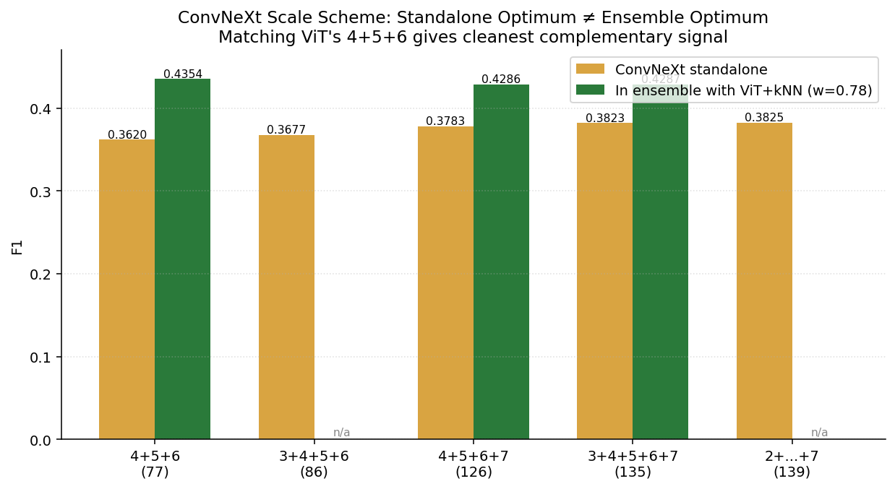

| ConvNeXt scheme | standalone F1 | in ensemble (w=0.78) |
|-----------------|--------------:|---------------------:|
| **4+5+6** | 0.3620 | **0.4354** |
| 4+5+6+7 | 0.3783 | 0.4286 |
| 3+4+5+6+7 | 0.3823 | 0.4287 |

**Blend formula (final).**
```
P_final(image) = 0.77 · P_vit+knn+temporal(image)
               + 0.23 · P_cnxt+temporal(image)
# then class_mask, threshold=0.100, topK=10
```

All quantities are 7806-d float-16 probability vectors. No re-normalisation after blend (the intersection of their geo masks is identical, and both sum ≤ 1).

**Weight sweep evidence.**

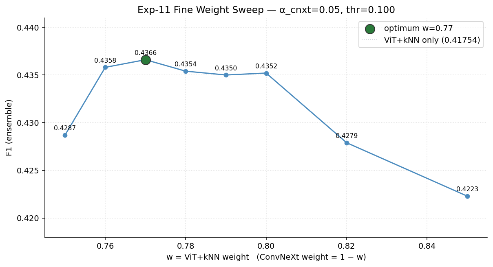

| w | F1 |
|--:|----:|
| 0.76 | 0.4358 |
| **0.77** | **0.4366** (→ 0.4379 after α_cnxt retune) |
| 0.78 | 0.4354 |
| 0.80 | 0.4352 |
| 0.85 | 0.4223 |

**ConvNeXt α final sweep (Round 3, produces F1=0.4379).**

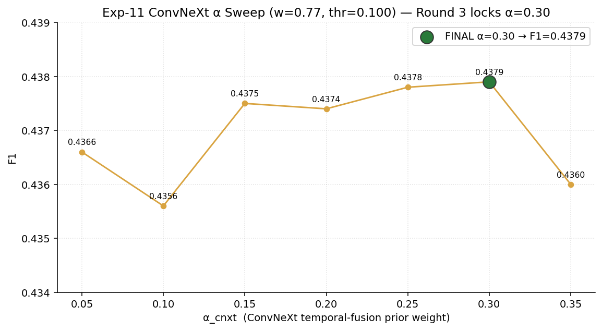

| α_cnxt | F1 |
|-------:|----:|
| 0.05 | 0.4366 |
| 0.15 | 0.4375 |
| 0.25 | 0.4378 |
| **0.30** | **0.4379** |
| 0.35 | 0.4360 |

**Reproducibility pointers.**
- Core fusion script: `Exp-11_Conv_ViT_Ensemble/ensemble_with_knn.py` (174 lines). The winning line is L162:
  ```python
  ens[name] = (w * P_vit_knn + (1 - w) * P_cnxt).astype(np.float16)
  ```
- Runs the ViT kNN stage first via `Exp-9_kNN_Retrieval_Ensemble/multiscale_aggregate_knn.py`.
- sbatch: `slurm_ensemble_with_knn.sbatch`, `slurm_final_tuning.sbatch`, `slurm_final_tuning2.sbatch`, `slurm_final_tuning3.sbatch` (the last one produces F1=0.4379).

---

### 4.9 Submission threshold and topK

**Decision.** Hard thresholding `p_image(c) ≥ 0.100` followed by a topK=10 cap is kept from Exp-4/Exp-7. Alternatives (adaptive per-image rules, see §8 Appendix A) were all worse.

| thr | F1 (w=0.78, α_cnxt=0.05) |
|----:|--:|
| 0.085 | 0.4201 |
| 0.090 | 0.4190 |
| 0.095 | 0.4267 |
| **0.100** | **0.4354** |
| 0.105 | 0.4316 |
| 0.110 | 0.4255 |

The optimum shifted from 0.04 (Exp-4 single-model) to 0.100 (Exp-11 ensemble) because the blended probabilities are systematically lower (mass spread across the two models), not because the calibration rule changed.

---

## 5. End-to-end reproducibility — exact command sequence

All commands are submitted from `user/alper/src/` on PACE with environment variable `PLANTCLEF_ROOT=/storage/home/hcoda1/2/aerten3/ps-clef2026_plantclef-0`. SLURM account: `paceship-clef2026_plantclef`.

> **Inputs assumed already present** (produced by Exp-7 and Exp-9):
> - ViT tile parquets: `${PLANTCLEF_ROOT}/aerten3/parquet/plantclef_2026_test/exp7_multiscale/scale_{4x4,5x5,6x6}.parquet`
> - FAISS index: `${PLANTCLEF_ROOT}/aerten3/exp9_knn/faiss_index/faiss_index_geo.bin` + `faiss_labels_geo.npy`
> - Species map: `${PLANTCLEF_ROOT}/data/raw/class_id_to_species_mapping/class_to_species_id.json`
> - Geo mask: `${PLANTCLEF_ROOT}/aerten3/species_masking/sw_europe_mask_bool.npy`
> - Test images: `${PLANTCLEF_ROOT}/data/raw/PlanCLEF_test_data/images/`
> - ConvNeXt-L Phase 2 checkpoint: `${PLANTCLEF_ROOT}/aerten3/checkpoints/exp10_convnext/convnext_large_phase2_4gpu/model_best.pth.tar`

| # | Command | Produces | Approx time |
|---|---------|----------|-------------|
| 1 | `sbatch Exp-11_Conv_ViT_Ensemble/slurm_extract_convnext_4x4.sbatch` | `exp11_ensemble/convnext_large/scale_4x4.parquet` (33 680 rows) | ~2 h H200 |
| 2 | `sbatch Exp-11_Conv_ViT_Ensemble/slurm_extract_convnext_5x5_6x6.sbatch` | `scale_5x5.parquet` (52 625) + `scale_6x6.parquet` (75 780) | ~6 h H200 |
| 3 | `sbatch Exp-11_Conv_ViT_Ensemble/slurm_ensemble_with_knn.sbatch` | ViT+kNN fused parquet **and** initial ensemble CSVs across w ∈ {0.78..0.95} at thr=0.100, α_cnxt=0.05 | ~8 h CPU |
| 4 | `sbatch Exp-11_Conv_ViT_Ensemble/slurm_final_tuning.sbatch` | thr sweep + α sweep + fine w sweep at w ∈ {0.76,0.77,0.79} | ~4 h CPU |
| 5 | `sbatch Exp-11_Conv_ViT_Ensemble/slurm_final_tuning2.sbatch` | α_cnxt ∈ {0.15, 0.20, 0.25} at w=0.77, thr=0.100 | ~2 h CPU |
| 6 | `sbatch Exp-11_Conv_ViT_Ensemble/slurm_final_tuning3.sbatch` | α_cnxt ∈ {0.30, 0.35} at w=0.77, thr=0.100 | ~2 h CPU |

**Final submission CSV (the one scoring 0.4379):**
```
${PLANTCLEF_ROOT}/aerten3/submissions/exp11_final_tuning3/w0.77_a0.30/ens_knn_w0.77_thr0.100_top10.csv
```

Total compute cost ≈ 8 GPU-h + 16 CPU-h on the H200 + cpu-medium partitions.

---

## 6. Full hyperparameter manifest (single-page cheat sheet)

```yaml
# === Preprocessing ===
jpeg:
  quality: 85
  subsampling: 1        # 4:2:2
  resize_filter: LANCZOS

# === Tiling (both models) ===
tiling:
  scales: [4, 5, 6]
  tiles_per_image: 77
  tile_size: 518

# === ViT branch ===
vit:
  model: vit_base_patch14_reg4_dinov2.lvd142m
  embed_dim: 768
  temperature: 1.5
  aggregation: max_prob
  image_topk: 64
  knn:
    index_type: IndexFlatIP
    metric: cosine
    n_vectors: ~860_000
    k: 20
    tau: 0.07
    beta_multi: 0.80
    beta_single: 1.00
    blend_point: per_tile_pre_aggregation
  temporal_fusion:
    strategy: prior_blend
    alpha: 0.15

# === ConvNeXt branch ===
convnext:
  model: convnext_large.dinov3_lvd1689m
  embed_dim: 1536
  finetune_phases: 2     # Exp-10 phase1 + phase2
  phase1: {epochs: 100, opt: adam,  lr: 0.01,  wd: 0.0,   layer_decay: none, drop_path: 0.05, freeze_backbone: true,  batch_per_gpu: 512, gpus: 4xH200}
  phase2: {epochs: 100, opt: adamw, lr: 3e-5, wd: 0.05,  layer_decay: 0.80, drop_path: 0.30, freeze_backbone: false, batch_per_gpu:  64, gpus: 4xH200, init_from: phase1_best_ema}
  temperature: 1.5
  aggregation: max_prob
  image_topk: 64
  temporal_fusion: {strategy: prior_blend, alpha: 0.30}

# === Ensemble ===
ensemble:
  approach: A              # kNN on ViT first, blend after
  fusion_point: probability_level
  weights: {vit_plus_knn: 0.77, convnext: 0.23}

# === Submission ===
submission:
  threshold: 0.100
  topk: 10
  geo_mask: sw_europe_mask_bool.npy
```

---

## 7. Key design decisions — the one-liner reasons

1. **`max_prob` over noisy-OR / mean / top-M.** Only aggregator whose F1 is invariant to tile count; essential precondition for multiscale.
2. **Scales 4+5+6, no 1/2/3/7.** Coarse scales emit confident garbage that max_prob promotes; 7×7 is diminishing return.
3. **kNN on ViT only, *before* ConvNeXt blend.** FAISS index was built from ViT embeddings; anything else mis-aligns the retrieval space.
4. **β_single = 1.00 (pure softmax for single-visit images).** Multi-visit images have the temporal prior to absorb kNN noise; single-visit images do not — injecting kNN there cost up to −0.08 F1.
5. **Same scale scheme (4+5+6) for both models in the ensemble.** Model disagreements at scales where only one model has confidence hurt more than the extra resolution helps.
6. **Different α per model.** ViT+kNN already has strong location-independent evidence → α=0.15 leans a bit toward the location prior. ConvNeXt has no kNN arm → α=0.30 trusts its per-image prediction more, preserving diversity.
7. **Fixed global threshold 0.100.** Every adaptive per-image rule tried in Exp-6 lost to fixed thresholds. The blended probability distribution is systematically lower than the single-model one, which is why 0.04 → 0.100 but the rule itself is unchanged.

---

## 8. Appendix — Rejected techniques (and why)

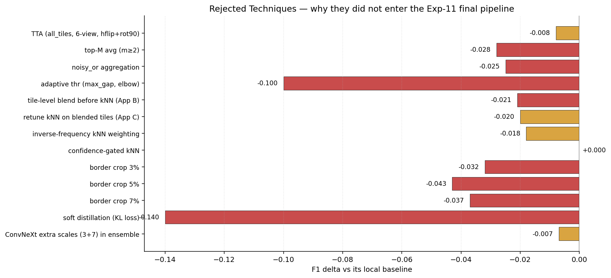

### A. Exp-6 — Adaptive per-image thresholding

Tested four strategies to let each image pick its own threshold: `max_gap`, `relative_ratio`, `elbow` (Kneedle-like), and a plain global threshold as control.

| strategy (best config) | F1 | vs fixed thr=0.040 |
|-----------------------|---:|---:|
| **fixed threshold 0.040** | **0.35698** | — |
| fixed threshold 0.045 (Exp-6 final sweep winner) | 0.35859 | +0.002 |
| relative_ratio (ratio=0.30) | 0.35380 | −0.003 |
| elbow (smooth=3, N=50) | 0.25418 | −0.103 |
| max_gap (any N) | ≈ 0.22 | broken (always K≈1.6) |

**Why rejected.** Within Exp-6's own pipeline, **none of the adaptive rules beat a well-tuned fixed threshold.** The probability calibration from `max_prob + T=1.5 + prior_blend` is globally consistent across images; no per-image meta-rule has leverage. Exp-11 inherited the "fixed threshold" principle and re-tuned the value (0.045 → 0.100) when the ensemble re-scaled probabilities.

### B. Exp-12 — Border cropping

Hypothesised that wooden frames / rulers / colour cards at image borders produce noisy edge-tile predictions. Tried uniform 3 / 5 / 7 % crops, with a "crop+resize-back" control to decompose dimension-change vs content-removal effects.

| condition | best F1 | vs baseline 0.35837 |
|-----------|---:|---:|
| baseline (no crop) | **0.35837** | — |
| crop 3 % | 0.32596 | −0.032 |
| crop 3 % + resize-back | 0.33280 | −0.026 |
| crop 5 % | 0.31565 | −0.043 |
| crop 5 % + resize-back | 0.33074 | −0.028 |
| crop 7 % | 0.32096 | −0.037 |
| crop 7 % + resize-back | 0.32725 | −0.031 |

Decomposition at 5 %: dimension change ≈ 35 % of the loss, content removal ≈ 65 %. **All variants hurt.** The borders contain real plant signal (vegetation overhangs the quadrat frames); the existing pipeline's defences (`max_prob`, geo mask, temporal prior, threshold 0.100) are already sufficient for frame artefacts. Not adopted.

### C. Exp-9 — Rare-species boosting strategies (Phase 4)

With kNN in place, tried to specifically amplify rare-species retrieval evidence.

| strategy | F1 | vs baseline 0.41153 |
|----------|---:|---:|
| **baseline (β_m=0.80, β_s=1.00)** | **0.41153** | — |
| inverse-frequency weighting `w *= 1/sqrt(count)` | 0.39307 | −0.018 |
| confidence-gated kNN (only if max softmax < 0.3) | 0.41153 | 0.000 |
| confidence-gated kNN (threshold 0.5) | 0.41153 | 0.000 |
| inv-freq + conf-gate | 0.39307 | −0.018 |

**Why rejected.** Rare species have *noisy* training images (few, highly variable); amplifying them amplifies the noise. Confidence gating is invisible to the downstream `max_prob` aggregation, so it has no effect.

### D. Exp-11 — Tile-level blend before kNN (Approaches B and C)

| approach | description | F1 |
|----------|-------------|---:|
| **A** (winner) | ViT+kNN fused → blend ConvNeXt after | **0.4354–0.4379** |
| B | ViT and ConvNeXt aggregated independently, then blend | 0.4224 |
| C | blend logits per-tile, then run kNN on blended logits | 0.4140–0.4145 |

C's kNN retune (swept k ∈ {5,10,20,50}, τ ∈ {0.05,0.07,0.10}, β ∈ {0.80..0.95}) could not recover Approach A's score because the FAISS index was built on ViT embeddings — blended logits with no matching embedding space confuse the retrieval.

### E. Exp-4 — Multi-view TTA and top-M averaging

| technique | F1 | vs orig_only max_prob T=1.5 |
|-----------|---:|---:|
| **orig_only (no TTA)** | **0.31950** | — |
| per_view_or (avg over {orig, hflip, rot90}) | 0.31487 | −0.005 |
| all_tiles (3× tile count) | ≈ 0.24 | catastrophic |
| six-view expansion (+rot180, rot270, vflip) | 0.31040 | −0.009 |
| top-M avg m=2 | 0.28703 | −0.032 |
| top-M avg m=3 | 0.28314 | −0.036 |

**Why rejected.** Backbones were trained on upright images; augmented views inject noise. Averaging the top-M tiles dilutes the single strong tile that `max_prob` relies on.

### F. Exp-4 — Noisy-OR / mean_prob / weighted_noisy_or aggregators

Per §4.3: all multiplicative or averaging aggregators degrade with increasing tile count (stdev 0.014–0.034 across k=6..16), which rules them out as soon as multiscale (77 tiles) enters the pipeline. `max_prob` is the only option that survives.

### G. Exp-3 — KL/Soft-distillation loss

Noted in project memory: training on all 7806 classes with a soft teacher target overwhelms the ~64 positive signals with ~7742 near-zero targets, causing mode collapse (F1 → 0). BCE with negative sampling restored F1 to 0.143 (Exp-1 lineage). Not in scope for this summary but remains the cautionary tale behind sticking with CE + label-smoothing 0.1 in Exp-10/Exp-13.

### H. Exp-13 — ViT-Large DINOv2 / DINOv3 finetune (planned upgrade, not yet in final)

Exp-13 trains two additional backbones aimed at replacing ViT-B DINOv2 in the ensemble:
- `vit_large_patch14_reg4_dinov2.lvd142m` (518×518, 304 M, 1024-d)
- `vit_large_patch16_dinov3.lvd1689m` (512×512 — patch-16 divisibility — 303 M, 1024-d)

Phase 1 recipe mirrors Exp-10 (head-only Adam, lr 0.01). Phase 2 diverges: **AdamW + wd 0.05 + layer-decay 0.75 + warmup 5 ep + drop-path 0.2**, departing from the original PlantNet ViT-B recipe because the 3× parameter count needs stronger regularisation. Currently planned/scaffolded; not yet part of the F1=0.4379 submission.

---

## 9. File index — where things live

| Artefact | Path |
|----------|------|
| Final submission CSV | `${PLANTCLEF_ROOT}/aerten3/submissions/exp11_final_tuning3/w0.77_a0.30/ens_knn_w0.77_thr0.100_top10.csv` |
| Final ConvNeXt checkpoint | `${PLANTCLEF_ROOT}/aerten3/checkpoints/exp10_convnext/convnext_large_phase2_4gpu/model_best.pth.tar` |
| FAISS index + labels | `${PLANTCLEF_ROOT}/aerten3/exp9_knn/faiss_index/{faiss_index_geo.bin, faiss_labels_geo.npy, class_counts_geo.npy}` |
| Geo mask | `${PLANTCLEF_ROOT}/aerten3/species_masking/sw_europe_mask_bool.npy` |
| Species map | `${PLANTCLEF_ROOT}/data/raw/class_id_to_species_mapping/class_to_species_id.json` |
| ViT tile parquets | `${PLANTCLEF_ROOT}/aerten3/parquet/plantclef_2026_test/exp7_multiscale/scale_{4x4,5x5,6x6}.parquet` |
| ConvNeXt tile parquets | `${PLANTCLEF_ROOT}/aerten3/parquet/exp11_ensemble/convnext_large/scale_{4x4,5x5,6x6}.parquet` |
| Fusion script (winner) | `user/alper/src/Exp-11_Conv_ViT_Ensemble/ensemble_with_knn.py` |
| ViT kNN stage | `user/alper/src/Exp-9_kNN_Retrieval_Ensemble/multiscale_aggregate_knn.py` |
| Aggregators | `user/alper/src/Exp-4_Enhanced_Tile_Aggregation/utils/aggregator.py` |
| Temporal fusion | `user/alper/src/Exp-4_Enhanced_Tile_Aggregation/temporal_fusion.py` |
| Multiscale extraction (ViT) | `user/alper/src/Exp-7_Multiscale_tiling/extract_multiscale_embeddings.py` |
| Multiscale extraction (ConvNeXt) | `user/alper/src/Exp-10_ConvNext_finetuning/extract_convnext_embeddings.py` |
| ConvNeXt training | `user/alper/src/Exp-10_ConvNext_finetuning/train_convnext.py` + `configs/phase{1,2}_large.yaml` |
| ViT-L training (planned) | `user/alper/src/Exp-13_ViT_finetuning/train_vit.py` + `configs/` |
| Figures for this doc | `user/alper/src/Final_pipeline_methods_Summary/figures/` |
| Figure-generator script | `user/alper/src/Final_pipeline_methods_Summary/generate_figures.py` |

---

*Document produced by synthesising nine parallel exploration reports over `Exp-2, Exp-4, Exp-6, Exp-7, Exp-9, Exp-10, Exp-11, Exp-12, Exp-13` plus the stored project memory. All numbers carried forward from the source experiment `docs/*Results_Summary.md` files without re-running the pipelines.*
